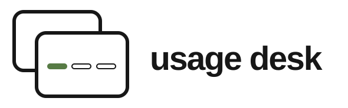
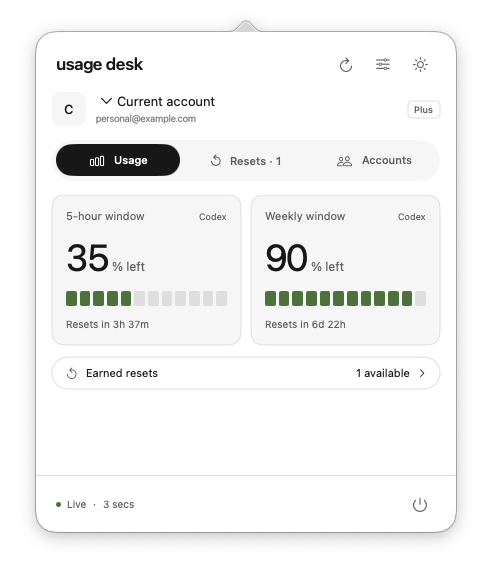

<p align="center"></p>
<p align="center">Codex usage, reset times, and accounts. One click from your Mac menu bar.</p>
<p align="center"><a href="LICENSE">MIT licensed</a> · macOS 14+ · SwiftUI + AppKit · No third-party Swift dependencies</p>



Usage Desk is a local menu bar utility for people who use more than one Codex account.
See your remaining quotas, when usage windows reset, and any earned resets returned by Codex.
Select an account in a compact list, or expand the same panel to manage its connection.

> **Distribution:** source only. No prebuilt installer is available.
> Get the source from [GitHub](https://github.com/NiKHiLkr23/usage-desk) and build it on your Mac using the instructions below.

## Features

- Remaining quota percentages and reset countdowns for reported usage windows.
- Earned-reset counts and details when Codex supplies them; redeem resets in Codex.
- Separate local sign-ins for added accounts; choose a Chrome profile or use your default browser.
- Quick account selection, expanded account management, and inline Preferences.
- One anchored panel, smooth resizing, full-row account hit targets, and quit confirmation.
- System appearance by default, optional Light/Dark overrides, and Reduce Motion support.
- Automatic refresh, wake refresh, optional menu bar percentage, and launch at login.

## Requirements

- macOS 14 or newer; Apple silicon or Intel. Local builds target your Mac by default.
- Xcode Command Line Tools with Swift 6 or newer to build the app.
- A recent **Codex CLI** with ChatGPT sign-in and app-server usage endpoints.
  Follow [OpenAI's Codex documentation](https://developers.openai.com/codex/cli/) to install and sign in.
- Chrome is optional. Multiple Chrome profiles can make multiple-account sign-in easier.

## Build and run

```sh
zsh scripts/build.sh
open "dist/Usage desk.app"
```

The script creates an ad-hoc-signed local build with the app icon. For a universal binary:

```sh
zsh scripts/build.sh --universal
```

Click the menu bar percentage (or “usage desk”) to open the panel. Move the app into
Applications before enabling launch at login. Local builds are not notarized distribution builds;
we do not ask users to disable Gatekeeper.

## Connect your accounts

1. Your current Codex CLI account is discovered automatically.
2. Open **Accounts → Add account**. Give it a label and choose a Chrome profile or the default browser.
3. Complete OpenAI sign-in in your browser, then verify the email shown in Usage Desk.
4. Repeat for each account, one sign-in at a time.
5. Click an account in the compact list to view its usage. **Manage accounts** opens its connection settings.

A Chrome profile's Google email can differ from its OpenAI email. The returned OpenAI email is authoritative.
The panel may close while Chrome is active; sign-in continues. Reopen it to check the result.
Removing an account stops tracking it and retains its local authentication files.

## What this app does and doesn't report

Usage Desk displays data returned by Codex. It does **not** expose every ChatGPT feature/model quota,
redeem resets, run model turns, buy credits, or switch the active Codex desktop/CLI login.
API-key-only accounts cannot report ChatGPT-plan quotas. Unknown values stay unknown;
a countdown reaching zero is not proof that a quota has replenished.

This is an independent community project, not affiliated with or endorsed by OpenAI or Apple.

## Privacy and local storage

There is no Usage Desk backend, analytics, or account service. Codex communicates with OpenAI
for authentication and usage reads. Added accounts use separate local Codex homes under:

```text
~/Library/Application Support/ResetDesk/accounts/<uuid>/
```

Labels are in `accounts.json` beside that folder. Codex stores credentials locally; treat these
files as sensitive. The existing bundle identifier and `ResetDesk` storage name remain stable
for compatibility. The website and app do not share accounts. See [Privacy](docs/PRIVACY.md)
and [Security](SECURITY.md).

## Development and contributions

```sh
swift test --scratch-path .build --cache-path .cache
node scripts/check-website.mjs
npm run preview
```

Open the local URL printed by the preview server. The website is buildless HTML/CSS/JS;
Node is only needed for local tooling. Tests use synthetic data by default and skip the two live checks.
See [CONTRIBUTING.md](CONTRIBUTING.md) for optional integration tests, screenshot mode, and pull requests.

- [Architecture](docs/ARCHITECTURE.md)
- [Brand assets](assets/brand/README.md)
- [Release and notarization](docs/RELEASING.md)
- [Website configuration](website/README.md)
- [Changelog](CHANGELOG.md)
- [Code of conduct](CODE_OF_CONDUCT.md)

## License

[MIT](LICENSE). Includes the original Usage Desk source and brand artwork in this repository.
OpenAI and Apple names and marks remain their owners' property. No rights to those marks are granted.
