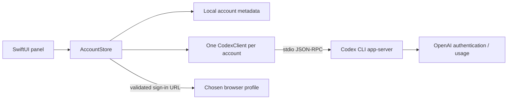

# Architecture

## Native app

`ResetDesk` is the SwiftUI/AppKit executable. `ResetDeskCore` contains the models, storage,
URL validation, login correlation, and JSON-RPC client. There are no third-party Swift packages.
Swift 6 compiles the package in Swift 5 language mode; minimum macOS is 14.

`AppDelegate` owns an `NSStatusItem`. `AppWindows` retains one transient `NSPopover` and
`DeskNavigation`. An AppKit-owned container retains the SwiftUI hosting controller as a child,
so appearance updates cannot discard the theme overlay’s backing layer. Usage, Resets, and quick Accounts share the
compact view. Manage/Add account expand the same panel. Preferences replaces its contents.
`PanelResizeAnimator` interpolates the content size over 280 ms; it cancels/reverses on a new
route and stops on dismissal. Reduce Motion skips resizing animation.

`AccountStore` is the main-actor model. It owns account metadata, per-account usage states,
refresh tasks, Codex clients, and a pending login independently of views. Dismissing the panel
does not cancel authentication. Drafts live in `DeskNavigation` for the current app session.

## Data flow

Each `CodexClient` owns one subprocess and pipe pair. Readability handlers feed a buffered
`AsyncStream<Data>` per process, avoiding the macOS shared blocking reader behavior of
`FileHandle.bytes`. Requests have timeouts. Client generations and login attempt IDs discard
stale replies. The allowed public calls are account/read, account/rateLimits/read,
account/login/start, and account/login/cancel. Initialization is internal protocol setup.

The current CLI profile uses the user's existing Codex home. Added profiles have distinct
local homes and use Codex's file credential store unless device policy overrides it.
The app does not overwrite the current CLI auth or switch the desktop app's active account.

## Compatibility

Keep `in.nikhilkr.resetdesk`, the internal module names, preference keys, and the
`ResetDesk` support folder stable unless a tested migration is provided.
`RESET_DESK_DATA_DIR` overrides metadata/added-account storage; `CODEX_HOME` identifies
the current CLI profile. The HTML prototype from development is not part of this project.

## Demo mode

`USAGE_DESK_DEMO=1` or a demo app bundle enables synthetic accounts. The store returns before
loading private metadata, reading Chrome profiles, registering polling/wake observers, or opening
Codex clients. Demo preferences have a separate domain. Account creation, authentication,
removal, and launch-at-login writes are blocked. The demo app has a distinct bundle identifier.

## Website

`website/` is static HTML/CSS/JS with no external fonts, cookies, backend, or account auth.
Production-only Vercel Web Analytics is separate from the app and sample preview (see `ANALYTICS.md`).
Its interactive app preview is an isolated HTML/CSS/JS reconstruction using fixed sample data.
No preview action reaches a CLI or account store. Native-style colors and motion are scoped in
`preview.css`; one `theme.js` controller synchronizes the website and preview.
GitHub actions use direct static HTTPS links. `release.json` records the repository URL for tooling;
the website does not fetch metadata or enable binary downloads. Local review archives are excluded
from the web root. See [website configuration](../website/README.md).

## Claude provider

`LocalAccount.provider` selects Codex or Claude. Absent provider fields decode as Codex; unknown
provider values fail decoding instead of being relabeled. Account homes and storage identifiers
retain their existing meaning. Claude metadata tracks an existing CLI configuration directory.

`ClaudeClient` starts a short-lived CLI control connection in a private empty working directory.
It sends only `initialize` and `get_usage` (`skip_behaviors: true`), correlates replies, refuses
CLI tool requests, bounds buffered output, uses a 45-second per-request deadline, and closes
on success, failure, timeout, or removal. It never sends a user message. Hooks, project settings,
MCP servers, tools, and session persistence are disabled for the probe; inherited API keys and
provider overrides are not forwarded. Claude CLI owns authentication and token refresh.

The control request is experimental in Anthropic SDK 0.3.309. Schema changes produce a recoverable
error, not guessed usage. T3's headless sessions do not run status-line commands; independent
usage reads avoid that dependency. Sources used to verify the wire format:
- https://www.npmjs.com/package/@anthropic-ai/claude-agent-sdk
- https://github.com/pingdotgg/t3code/blob/main/apps/server/src/provider/ClaudeProvider.ts
- https://github.com/pingdotgg/t3code/blob/main/apps/server/src/provider/claudeUsageLimits.ts

Normal tests use only `Fixtures/fake-claude.py`. A live check requires explicitly setting
`RESET_DESK_LIVE_CLAUDE` to the CLI path; it does not print account identity, limits, or raw replies.

## Appearance transitions

`ThemeRevealTransition` snapshots only the owning AppKit content view in memory and masks the old
image with an expanding circular hole. The new appearance is applied immediately underneath; the
click-through overlay lasts 480 ms and is removed on completion, rapid replacement, navigation,
dismissal or Reduce Motion changes. Failed capture and missing anchors apply appearance instantly.
`DeskAppearanceBridge` applies the saved choice when the owning popover attaches and when it changes.
The theme button also updates that window immediately. An explicit SwiftUI color-scheme environment
keeps semantic colors in sync; System removes the application override and applies its resolved
appearance to the popover. A window-scoped observation follows subsequent app appearance changes.
This avoids inheriting a fixed dark appearance from the menu-bar anchor.
System remains the default. No screen recording, file export or account operation is involved.
The website uses the View Transition API for the equivalent reveal, with immediate fallbacks.
