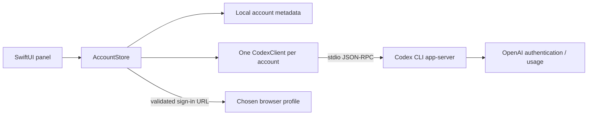

# Architecture

## Native app

`ResetDesk` is the SwiftUI/AppKit executable. `ResetDeskCore` contains the models, storage,
URL validation, login correlation, and JSON-RPC client. There are no third-party Swift packages.
Swift 6 compiles the package in Swift 5 language mode; minimum macOS is 14.

`AppDelegate` owns an `NSStatusItem`. `AppWindows` retains one transient `NSPopover` and
`DeskNavigation`; SwiftUI fills its hosting view. Usage, Resets, and quick Accounts share the
compact view. Manage/Add account expand the same panel. Preferences replaces its contents.
`PanelResizeAnimator` interpolates the content size over 280 ms; it cancels/reverses on a new
route and stops on dismissal. Reduce Motion skips resizing animation.

`AccountStore` is the main-actor model. It owns account metadata, per-account usage states,
refresh tasks, Codex clients, and a pending login independently of views. Dismissing the panel
does not cancel authentication. Drafts live in `DeskNavigation` for the current app session.

## Data flow

Each `CodexClient` owns one subprocess and pipe pair. Readability handlers feed a buffered
`AsyncStream<Data>` per process, avoiding the macOS shared blocking reader behavior of
`FileHandle.bytes`. Requests have timeouts. Client generations and login attempt IDs discard
stale replies. The allowed public calls are account/read, account/rateLimits/read,
account/login/start, and account/login/cancel. Initialization is internal protocol setup.

The current CLI profile uses the user's existing Codex home. Added profiles have distinct
local homes and use Codex's file credential store unless device policy overrides it.
The app does not overwrite the current CLI auth or switch the desktop app's active account.

## Compatibility

Keep `in.nikhilkr.resetdesk`, the internal module names, preference keys, and the
`ResetDesk` support folder stable unless a tested migration is provided.
`RESET_DESK_DATA_DIR` overrides metadata/added-account storage; `CODEX_HOME` identifies
the current CLI profile. The HTML prototype from development is not part of this project.

## Demo mode

`USAGE_DESK_DEMO=1` or a demo app bundle enables synthetic accounts. The store returns before
loading private metadata, reading Chrome profiles, registering polling/wake observers, or opening
Codex clients. Demo preferences have a separate domain. Account creation, authentication,
removal, and launch-at-login writes are blocked. The demo app has a distinct bundle identifier.

## Website

`website/` is static HTML/CSS/JS with no external fonts, trackers, cookies, backend, or account auth.
Its product images are actual macOS app captures with account details anonymized, plus exact crops.
GitHub actions use direct static HTTPS links. `release.json` records the repository URL for tooling;
the website does not fetch metadata or enable binary downloads. Local review archives are excluded
from the web root. See [website configuration](../website/README.md).
